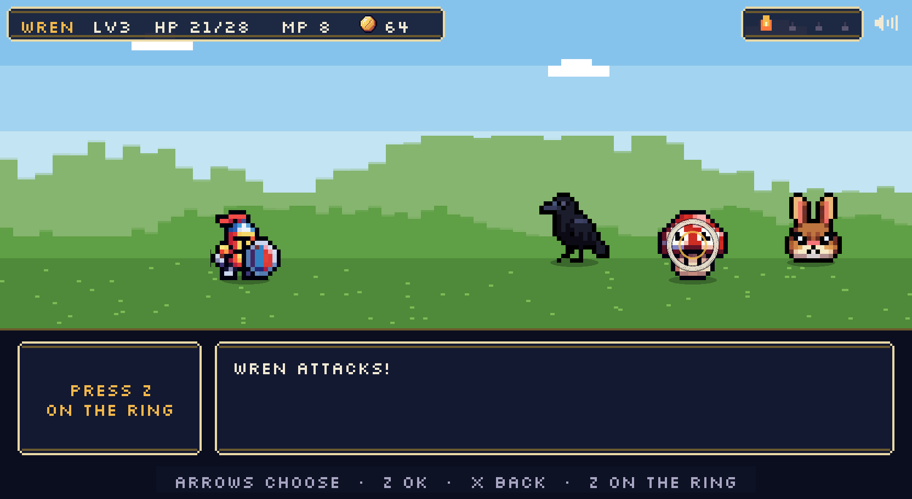

<div align="center">

# Heroic Crusader

**Four beacons. One squire. The Gloam.**

A storybook role-playing game about a squire who sets out to relight the beacons of a kingdom gone grey. It runs in the browser with a keyboard or a controller.

### [▶ Play it now](https://leeeeeroyj.github.io/heroic-crusader/)

[](https://github.com/leeeeeroyj/heroic-crusader/actions/workflows/deploy.yml)


[](LICENSE)



</div>

## About

Heroic Crusader is an original role-playing game inspired by the mechanics of Chunsoft and Enix's 1986 game *Dragon Quest*. The Gloam has put out the four beacons of a small kingdom, and the land has gone grey. A squire from Brightkeep takes the vow to light them again.

- **A whole kingdom to walk.** Meadow, marsh, snowfields and ruins, joined by roads and bridges, with three towns, a hermit's hut and four beacon towers to find.
- **The land shows what's lit.** Every region stays grey and violet under the Gloam until its beacon burns, then its colour comes back.
- **Side-view fights.** Creatures jump out as you walk, more often on rough ground. Beaten ones aren't killed: they shake off the Gloam and run home.
- **Valor timing.** A ring closes as each blow lands. Press on it for a strike half again as hard, or to halve a blow aimed at you.
- **Creatures with tricks.** Rooks snatch your gold, wolves howl for the pack, toads poison, wisps hush your spells, cairns brace behind stone.
- **Eight spells** learned as you rise, from Mend and Spark to Flare and Homeward.
- **Towns to rest in.** Three towns and a hermit's hut, with a smith, a grocer, an inn and a shrine where you record your journey. Name your squire, save, and carry on later.
- **Hand-drawn map, code-drawn tiles.** Forests, hills, rivers, mountains, roads and battle backdrops are all painted in code.
- **Keyboard or controller,** with hints that follow the last one you touched.

## How to play

- Walk the map a tile at a time. Hold a direction to keep walking.
- Mountains and rivers block the way; bridges and roads get you across.
- Step onto a town to go in; walk out through the gap at the bottom to leave. Step onto a beacon tower to see its name.
- Esc (or Start) opens the menu: your squire's status, spells and items to use on the road, and the way back to the title.
- The four flames at the top right are the beacons: grey while cold, burning once lit. The wall round Gloam's Hollow, in the far north-east, stays shut until all four burn.
- The top left shows your squire: name, level, HP, MP and gold. HP turns green while you're poisoned.

### Towns

- Walk up to someone and press Z (or A) to talk. Shopkeepers stand behind their counters: talk to them across it.
- **Queen Maren**, in Brightkeep's hall, tells you where to go next and how much Valor you need for your next level.
- **The smith** sells weapons, armour and shields. Buying a piece puts it on and trades your old one in for half its price, so you pay the difference. The shop shows how much your attack or defence will change before you buy.
- **The grocer** sells herbs, remedies, incense and torches, and buys what's in your pack for half price.
- **The inn** refills HP and MP and cures poison for a few gold (6 in Brightkeep, 12 in Fenbridge, 20 in Frostholm).
- **The shrine keeper** cures poison for free and records your journey. Your last shrine is where you wake if you fall, and where Homeward takes you.
- The hermit, out east, sells iron keys.

### Saving

- Your journey is saved only at a shrine, in one slot in this browser. The title screen then offers **Continue**.
- **New journey** asks for your squire's name: type up to eight letters, then press Enter. A controller keeps the name Wren.

### Fights

- Creatures jump out at random as you walk, never within five steps of the last fight. Roads and bridges are safest (1 step in 48); sand 1 in 30; grass 1 in 22; forest and snow 1 in 14; hills 1 in 12; marsh and rubble 1 in 10. Where a beacon burns, they come a third less often.
- What you meet depends on the ground under you: grass, forest and roads anywhere have the meadow's creatures, and marsh, snow, hills and rubble each have their own, tougher ones.
- **FIGHT** strikes one foe (choose which when there are several). **SPELL** casts a spell you know, if you have the MP. **ITEM** uses something from your pack. **FLEE** gets you away about two times in three; when it fails, the foes still act.
- You act first, then each foe, quickest first. A foe much quicker than you may strike before your first turn, and a quick one may act before you in any round. Each one flashes white before it acts.
- **Valor timing:** a ring closes on the target as each blow lands. Press confirm within about a tenth of a second of it closing: your strike does 1.5 times the damage, or a foe's blow does half. Press too early or late and nothing is lost. Once in a while a strike is a heroic blow that goes straight through armour.
- Beating creatures earns Valor (experience) and gold. Enough Valor raises your level: more HP, MP, attack and defence. LV 2 needs 7 Valor, LV 3 needs 23, LV 4 needs 47.
- **Sleep** costs you your next turn. **Poison** stings each round and each step on the map (never below 1 HP) until a remedy or a night's rest cures it. **Hush** stops your spells for the rest of the fight. A sleeping foe wakes when it's hurt; a braced one takes half damage.
- If you fall, you wake at your last shrine with full HP and half your gold.

| Creature | Found on | HP | Attack | Defence | Agility | Valor | Gold | Tricks |
|---|---|---|---|---|---|---|---|---|
| Thornhare | Meadow | 5 | 7 | 3 | 12 | 1 | 2 | quick: may strike before you |
| Rook | Meadow, Hills | 6 | 8 | 4 | 10 | 2 | 3 | snatches gold and flies off |
| Puffcap | Meadow, Hills, Marsh | 9 | 8 | 6 | 3 | 3 | 4 | spores put you to sleep |
| Duskbat | Hills | 10 | 11 | 6 | 14 | 4 | 5 | drinks half the HP it takes |
| Bogtoad | Marsh | 24 | 22 | 14 | 4 | 9 | 10 | bite can poison |
| Marshwisp | Marsh | 16 | 18 | 12 | 18 | 10 | 12 | casts Spark (6-10); dodges strikes |
| Rotcap | Marsh | 20 | 20 | 14 | 5 | 11 | 12 | spores poison |
| Frostfang | Snow | 30 | 32 | 20 | 16 | 18 | 20 | howls for help |
| Rimehare | Snow | 22 | 30 | 18 | 22 | 16 | 15 | bites twice |
| Frostwisp | Snow | 26 | 26 | 22 | 20 | 20 | 22 | casts Hush; dodges strikes |
| Rustguard | Ruins | 40 | 42 | 40 | 8 | 30 | 35 | — |
| Cairn | Ruins | 60 | 46 | 34 | 4 | 34 | 30 | braces every other turn |
| Gloombat | Ruins | 30 | 40 | 26 | 24 | 24 | 25 | drinks all the HP it takes |
| Grim Rook | Ruins | 28 | 36 | 24 | 22 | 22 | 28 | snatches gold and flies off; casts Spark (12-18) |

A blow does (attack − defence ÷ 2) × 0.35 to 0.5. Your squire starts at LV 1 with an Oak Stick (+4 attack), a Quilted Tunic (+2 defence), two herbs and 20 gold.

| Gear | Slot | Adds | Price | Sold in |
|---|---|---|---|---|
| Oak Stick | Weapon | +4 attack | 10 | You start with it |
| Hunter's Knife | Weapon | +10 attack | 45 | Brightkeep, Fenbridge |
| Iron Blade | Weapon | +18 attack | 180 | Fenbridge, Frostholm |
| Frostbrand | Weapon | +28 attack | 520 | Frostholm |
| Quilted Tunic | Armour | +2 defence | 8 | You start with it |
| Hide Vest | Armour | +6 defence | 35 | Brightkeep, Fenbridge |
| Ring Coat | Armour | +12 defence | 150 | Fenbridge, Frostholm |
| Scale Coat | Armour | +20 defence | 440 | Frostholm |
| Wicker Shield | Shield | +3 defence | 25 | Brightkeep |
| Iron Buckler | Shield | +8 defence | 120 | Fenbridge, Frostholm |
| Kite Shield | Shield | +14 defence | 360 | Frostholm |

### Spells and items

| Spell | Learned at | MP | Where | What it does |
|---|---|---|---|---|
| Mend | LV 3 | 3 | Both | Heals 17-23 HP |
| Spark | LV 4 | 2 | Battle | 8-12 fire damage to one foe |
| Glow | LV 5 | 2 | Map | Lights dark places |
| Lull | LV 7 | 2 | Battle | Puts foes to sleep for 2-3 turns (each resists 1 time in 4) |
| Ward | LV 9 | 2 | Map | Weaker creatures keep away for 200 steps |
| Homeward | LV 10 | 6 | Map | Takes you back to your home shrine |
| Flare | LV 12 | 5 | Battle | 22-30 fire damage to every foe |
| Restore | LV 14 | 8 | Both | Heals 75-90 HP |

A **herb** (10 gold) heals 22-28 HP, in battle or on the road; the pack holds up to six. A **remedy** (12) cures poison. **Incense** (30) keeps weaker creatures away for 120 steps. "Weaker" means too weak to hurt you through your armour. **Torches** (8) and **iron keys** (40) are for the dark places under the beacons.

## Controls

| Action | Keyboard | Controller |
|---|---|---|
| Walk, choose | Arrows / WASD | D-pad / left stick |
| Confirm; talk; strike or guard on the ring | Z / Space / Enter | A |
| Back | X / Backspace | B |
| Menu (status, spells, items, title) | Esc | Start |
| Sound on/off | M (or click the speaker) | Back |

## Run it locally

You need [Node.js](https://nodejs.org/) 20.19+ or 22.12+.

```bash
npm install
npm run dev        # http://localhost:5173
npm run build      # type-check and build to dist/
```

Every push to `main` builds the game and deploys it to GitHub Pages.

## Project layout

```
src/
  main.ts            game setup
  config.ts          tunables: screen, walking, level table, sprites, colours
  state.ts           the journey: the hero, gear, pack and beacons
  shop.ts            buying, selling and the inn
  save.ts            the save slot, checked field by field when it's read
  world.ts           map rules: walking, regions, paths, encounters
  battle.ts          battle rules, played out as a list of events
  field.ts           spells and items used on the map
  data/maps.ts       the overworld, its sites and the town maps
  data/people.ts     townsfolk, their lines and their shops
  tiles.ts           code-drawn tiles, battle backdrops and recoloured kin
  controls.ts        keyboard and gamepad input
  effects.ts         sparks, shake and flash
  sfx.ts             procedural sound effects
  scenes/            title screen, the world and towns, battles, talking, the menu and the HUD
assets/sprites/      the game's 16 × 16 sprites
design/              concept sheet and build plan
tools/sprites.py     sprite search and export script
tools/cdp.mjs        headless Chrome harness for the tests
tools/m*-test.mjs    checks for each milestone
```

## Credits

- **Sprites:** from the CC0 [Angais/pixel-art-atlas-1.4m](https://huggingface.co/datasets/Angais/pixel-art-atlas-1.4m) collection of AI-generated pixel art, found with [Pixel Search](https://huggingface.co/spaces/cfahlgren1/pixel-search).
- **Font:** [Silkscreen](https://fonts.google.com/specimen/Silkscreen) by Jason Kottke (SIL Open Font License).
- **Engine:** [Phaser](https://phaser.io/).
- **Inspiration:** Chunsoft and Enix's *Dragon Quest*. Heroic Crusader is an original game and isn't affiliated with or endorsed by the original's rights holders.

## License

Code: [MIT](LICENSE). Sprites: CC0. Font: SIL Open Font License.
